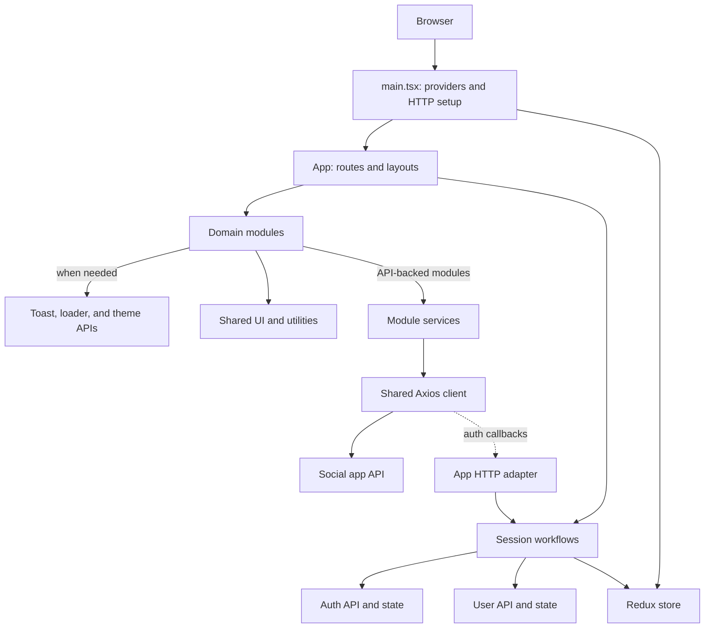

# Insta Social

**An API-connected social app built with React, TypeScript, and Redux Toolkit.**

An Instagram-inspired single-page application for sharing posts and interacting with a community. The project emphasizes domain-oriented organization, typed state and forms, resilient authentication requests, and behavior-focused component tests..

## Product Scope

- Browse the authenticated feed; create and edit image posts, like posts, and discuss them in comments.
- Sign up, sign in, restore an existing session, and view or edit a profile.
- Friends, chat, and notifications routes are present as under-construction placeholders; those workflows are not implemented yet.
- Use cross-cutting loader, toast, and theme capabilities for consistent application feedback.

## Engineering Highlights

- **Domain-oriented modules:** modules group the UI, service calls, validation, state, and focused tests relevant to each capability. They stay lightweight when a layer is not needed, and `index.ts` files define their supported public APIs.
- **Enforced dependency direction:** ESLint prevents shared code from depending on app or domain modules, prevents modules from depending on app-store composition, and restricts module-to-module imports to public entry points.
- **Composition at the application edge:** the app owns route and layout composition; `main.tsx` wires the Redux provider, router, and HTTP callbacks without pushing those concerns into domain modules.
- **Explicit state ownership:** Redux Toolkit holds session, user, theme, loader, and toast state. Screen-specific data and interactions remain local when they do not need to be shared.
- **Centralized request and auth handling:** module services use one Axios client for credentials and authorization. An app-level adapter supplies token and session callbacks, keeping the HTTP utility independent of the store and auth module.
- **Validated form and API boundaries:** Zod schemas define constraints and inferred form types; service methods handle endpoint details, multipart post uploads, empty responses, and unexpected status codes.
- **Behavior-focused testing:** Vitest and Testing Library cover routes, forms, services, schemas, Redux slices, and shared UI. A reusable render helper supplies isolated Redux and router context.
- **Reusable presentation layer:** shared controls and utilities complement module-owned screens, with SCSS modules for component-level styling.

## Architecture



### Request and authentication lifecycle

At startup, `main.tsx` configures the HTTP callbacks before rendering the app. The app restores the session, obtains a token, then fetches the current user; the loading state is shown while this is in progress. Requests use cookies and the current authorization token. If the API reports an expired token, the client refreshes it and retries the failed request; a signed-out response clears the session. Protected routes render only for an authenticated session, otherwise redirecting to `/auth/login`.

### Code organization

| Area          | Responsibility                                                                                   |
| ------------- | ------------------------------------------------------------------------------------------------ |
| `src/app`     | Route and layout composition, application startup, Redux store composition, and app-level wiring |
| `src/modules` | Domain modules with their own UI, services, state, and public `index.ts` API                     |
| `src/shared`  | Domain-agnostic UI primitives, utilities, constants, and infrastructure such as the HTTP client  |
| `src/test`    | Shared render helpers and test setup                                                             |

### Implementation examples

| Concern                  | Example                                                                                                                                                  |
| ------------------------ | -------------------------------------------------------------------------------------------------------------------------------------------------------- |
| HTTP and auth boundary   | [`http.ts`](src/shared/lib/http.ts) centralizes request interceptors; [`configure-http.ts`](src/app/configure-http.ts) injects app-owned auth callbacks. |
| Session coordination     | [`session-workflows.ts`](src/app/session-workflows.ts) composes Auth and User APIs without a direct module-to-module dependency.                         |
| Typed form validation    | [`post-validation.ts`](src/modules/posts/post-validation.ts) defines Zod constraints and derives the form types from the schemas.                        |
| Isolated component tests | [`render.tsx`](src/test/render.tsx) provides a test Redux store and memory router so components can be tested with their required context.               |

### Cross-cutting capabilities

Loader and Toast are app-wide feedback capabilities under `src/shared/feedback`; they own global progress/notification state, display hosts, and APIs used by other modules. Theme remains a cross-cutting module under `src/modules`. Shared feedback remains domain-agnostic and does not own module workflows or business state.

Module-to-module imports use the other module's public entry point (`modules/<module>`), not its implementation files. ESLint enforces this boundary and prevents modules from importing app store composition, routing, layouts, startup, or session workflows. Modules may use `app/hooks/redux-hooks` as their typed Redux integration API. Shared code cannot import app or domain modules.

### Module dependencies

Current domain dependencies are intentional UI or use-case composition:

| Module  | Depends on      |
| ------- | --------------- |
| `auth`  |                 |
| `home`  | `posts`, `user` |
| `user`  | `posts`         |
| `posts` |                 |

The app composes modules, including Auth and User for session workflows. Cross-cutting modules may be consumed by domain modules. Keep module dependencies acyclic; when a workflow needs multiple modules, coordinate them in `src/app` rather than adding reciprocal module imports.

### State ownership

Redux stores application state such as authenticated user details and the auth token, plus shared feedback state for loader and toast and cross-cutting theme state. Module screens keep short-lived interaction state local when it does not need to be shared; for example, the home feed owns its loaded posts and selected comment modal.

## Stack

- React 18, TypeScript 5 (strict mode), and Vite 7
- Redux Toolkit and React Redux
- React Router 6
- Axios
- Material UI with Emotion
- React Hook Form, Zod, and `@hookform/resolvers`
- SCSS modules
- Vitest, jsdom, and React Testing Library

## Getting Started

### Prerequisites

- Node.js 22 or newer
- Yarn 1.22

### Install and run

```bash
yarn install
yarn dev
```

The development server prints its local URL when it starts.

### Build and preview

```bash
yarn build
yarn preview
```

`yarn build` runs the TypeScript compiler before creating the Vite production bundle.

## Quality Checks

```bash
yarn test:run       # Run the test suite once
yarn test:coverage  # Run tests with V8 coverage
yarn lint           # Run ESLint with warnings treated as errors
yarn format         # Format source files with Prettier
```

Tests live alongside the source they exercise. The suite uses jsdom and Testing Library for user-visible behavior, with shared providers for stateful and routed components. Coverage can be inspected with `yarn test:coverage`; no coverage threshold is currently enforced by the Vitest configuration.

## Routes

| Route            | Access    | Screen                      |
| ---------------- | --------- | --------------------------- |
| `/`              | Protected | Home feed                   |
| `/friends`       | Protected | Friends (placeholder)       |
| `/chat`          | Protected | Chat (placeholder)          |
| `/notifications` | Protected | Notifications (placeholder) |
| `/profile`       | Protected | Profile                     |
| `/auth/login`    | Public    | Login                       |
| `/auth/signup`   | Public    | Sign up                     |

## API Configuration

The API base URL and server mode are defined in `src/shared/lib/env.ts`. The current base URL is `http://localhost:4000/api`; change `ENV.VITE_API_URL` there to use another backend. The configuration is currently a source constant rather than a Vite environment variable.

The Axios client uses `withCredentials: true`, so a cross-origin API must allow credentialed requests from the app origin and configure cookie attributes appropriately. Authentication refresh and protected-route behavior depend on the API's auth endpoints and error types.

## Scripts

| Command              | Description                            |
| -------------------- | -------------------------------------- |
| `yarn dev`           | Start the Vite development server      |
| `yarn build`         | Type-check and build for production    |
| `yarn preview`       | Serve the production build locally     |
| `yarn test`          | Start Vitest in watch mode             |
| `yarn test:run`      | Run Vitest once                        |
| `yarn test:ui`       | Open the Vitest UI                     |
| `yarn test:coverage` | Run tests and report V8 coverage       |
| `yarn lint`          | Run ESLint                             |
| `yarn format`        | Format files under `src` with Prettier |
