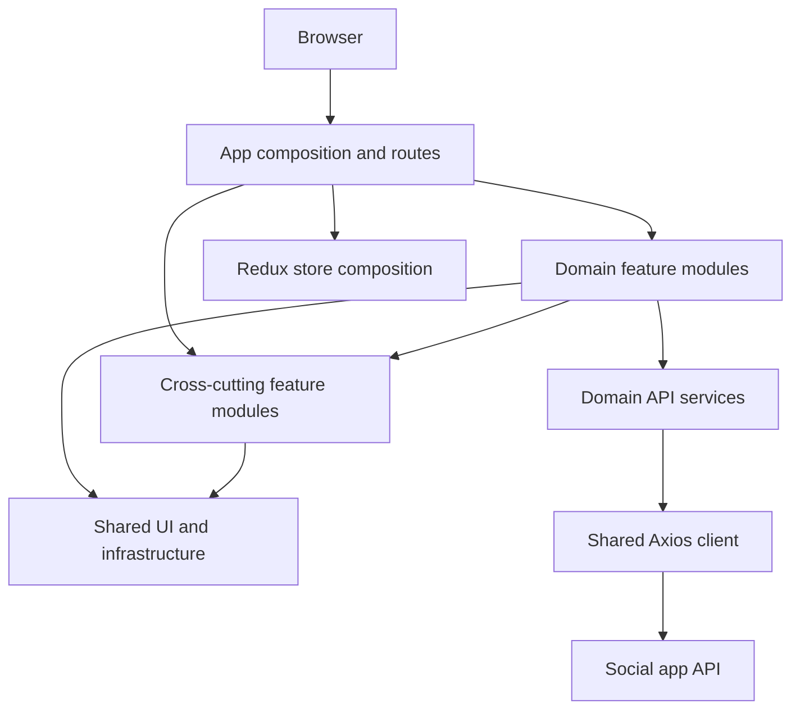

# Insta Social

**A full-stack-connected social app built with React, TypeScript, and Redux Toolkit.**

An Instagram-inspired single-page application for sharing posts and interacting with a community. The project emphasizes domain-oriented organization, typed state and forms, resilient authentication requests, and behavior-focused component tests.

</div>

## Product Scope

- Browse a post feed, create and edit image posts, and manage captions.
- Like posts and open comments for discussion.
- Sign up, sign in, view and edit a profile, and manage friends.
- Navigate chat and notifications areas within the authenticated application.
- Use cross-cutting loader, toast, and theme capabilities for consistent application feedback.

## Engineering Highlights

- **Feature-oriented architecture:** UI, services, validation, and tests are grouped by product domain instead of being organized only by technical layer.
- **Explicit application state:** Redux Toolkit slices represent user/session and auth state, with cross-cutting theme, loader, and toast state exposed through typed hooks.
- **Centralized API boundary:** a configured Axios client applies credentials and authorization consistently, and handles expired-token refresh and signed-out responses.
- **Route and layout composition:** React Router nests authenticated application pages under layouts while keeping login and signup public.
- **Validated form boundaries:** React Hook Form and Zod schemas keep form types, constraints, and user-facing validation close to each feature.
- **Testable UI composition:** Vitest, Testing Library, and a shared render helper provide Redux and router context for component-level behavior tests.
- **Reusable presentation system:** shared controls, headers, menus, modals, loaders, and SCSS modules keep feature screens composable.

## Architecture



### Request and authentication lifecycle

The app fetches the current user during startup. The configured HTTP client sends cookies and the current authorization token, refreshes credentials when the API reports an expired token, and clears user state when the API reports a signed-out session. Protected routes render only when user details are available; otherwise, navigation redirects to `/auth/login`.

### Code organization

| Area           | Responsibility                                                                                   |
| -------------- | ------------------------------------------------------------------------------------------------ |
| `src/app`      | Route and layout composition, application startup, Redux store composition, and app-level wiring |
| `src/features` | Feature modules with their own UI, services, state, and public `index.ts` API                    |
| `src/shared`   | Domain-agnostic UI primitives, utilities, constants, and infrastructure such as the HTTP client  |
| `src/test`     | Shared render helpers and test setup                                                             |

### Cross-cutting capabilities

Toast, loader, and theme are cross-cutting feature modules under `src/features`, not generic `shared` primitives. They own app-wide behavior and state, and expose the capabilities other modules need through their public entry points. Domain features may depend on those public APIs; `shared` must remain domain-agnostic and must not own feature workflows or business state.

Feature-to-feature imports use the other feature's public entry point (`features/<feature>`), not its implementation files. ESLint enforces this boundary and prevents `shared` from importing feature modules.

### Feature dependencies

Current domain dependencies are intentional UI or use-case composition:

| Feature   | Depends on                                    |
| --------- | --------------------------------------------- |
| `auth`    | `user`, `toast`                               |
| `home`    | `posts`, `like`, `comment`, `user`, `toast`   |
| `user`    | `posts`, `like`, `comment`, `loader`, `toast` |
| `comment` | `toast`                                       |
| `posts`   | `toast`                                       |

The app composes feature modules, while cross-cutting modules may be consumed by domain features. Keep this graph acyclic; add a dependency only when a feature needs that module's public capability. If a dependency would create a cycle, keep the coordination at the screen or app-composition level instead of adding reciprocal imports.

### State ownership

Redux stores application state such as authenticated user details and the auth token, plus cross-cutting theme, loader, and toast state. Feature screens keep short-lived interaction state local when it does not need to be shared; for example, the home feed owns its loaded posts and selected comment modal.

## Stack

- React 18, TypeScript 5 (strict mode), and Vite 7
- Redux Toolkit and React Redux
- React Router 6
- Axios
- Material UI with Emotion
- React Hook Form, Zod, and `@hookform/resolvers`
- SCSS modules
- Vitest, jsdom, and React Testing Library

## Getting Started

### Prerequisites

- Node.js 22 or newer
- Yarn 1.22

### Install and run

```bash
yarn install
yarn dev
```

The development server prints its local URL when it starts.

### Build and preview

```bash
yarn build
yarn preview
```

`yarn build` runs the TypeScript compiler before creating the Vite production bundle.

## Quality Checks

```bash
yarn test:run       # Run the test suite once
yarn test:coverage  # Run tests with V8 coverage
yarn lint           # Run ESLint with warnings treated as errors
yarn format         # Format source files with Prettier
```

Tests live alongside the source they exercise. The suite uses jsdom and Testing Library for user-visible behavior, with shared providers for stateful and routed components. Coverage can be inspected with `yarn test:coverage`; no coverage threshold is currently enforced by the Vitest configuration.

## Routes

| Route            | Access    | Screen        |
| ---------------- | --------- | ------------- |
| `/`              | Protected | Home feed     |
| `/friends`       | Protected | Friends       |
| `/chat`          | Protected | Chat          |
| `/notifications` | Protected | Notifications |
| `/profile`       | Protected | Profile       |
| `/auth/login`    | Public    | Login         |
| `/auth/signup`   | Public    | Sign up       |

## API Configuration

The API base URL and server mode are defined in `src/configs/env.ts`. The current configuration points to the hosted API. Update `API_URL` there when using another backend.

The Axios client uses `withCredentials: true`, so the API must allow credentialed cross-origin requests from the app origin and configure cookie attributes appropriately. Authentication refresh and protected-route behavior depend on the API's auth endpoints and error types.

## Scripts

| Command              | Description                            |
| -------------------- | -------------------------------------- |
| `yarn dev`           | Start the Vite development server      |
| `yarn build`         | Type-check and build for production    |
| `yarn preview`       | Serve the production build locally     |
| `yarn test`          | Start Vitest in watch mode             |
| `yarn test:run`      | Run Vitest once                        |
| `yarn test:ui`       | Open the Vitest UI                     |
| `yarn test:coverage` | Run tests and report V8 coverage       |
| `yarn lint`          | Run ESLint                             |
| `yarn format`        | Format files under `src` with Prettier |
